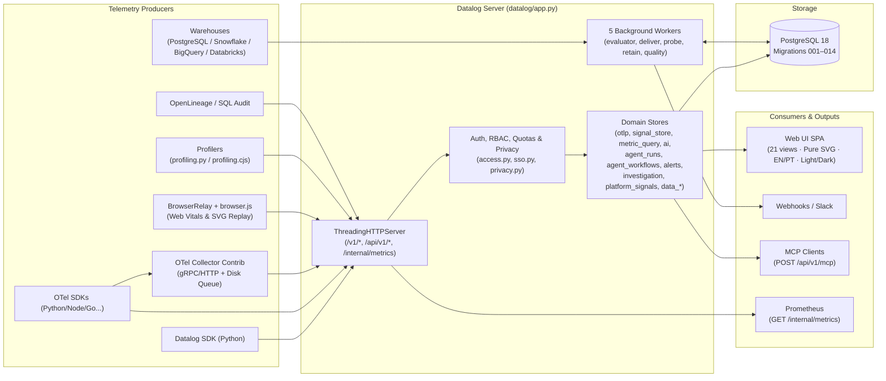

# Datalog Architecture

This document describes the technical architecture of **Datalog** (SynapseDev / SynapseAI), including ingestion and query flows, security and privacy boundaries, PostgreSQL storage and migrations, background workers, and the zero-dependency web interface.

---

## 1. System Overview

Datalog is a **modular monolith backed by a single PostgreSQL 18 database**, built on Python's standard library (`ThreadingHTTPServer`), `psycopg 3` (`ConnectionPool`), and `opentelemetry-proto`. It requires no external message brokers or multi-database clusters to run in development or production.

---

## 2. Backend Modules (`datalog/`)

The [`Store`](../datalog/app.py) class composes all domain stores over a shared `psycopg_pool.ConnectionPool` with transactional context blocks (`with store.connect() as db:`):

| Package | Modules | Responsibility |
| --- | --- | --- |
| **Entry points** (`datalog/`) | `app.py`, `server.py`, `routes.py`, `__main__.py`, `run_local.py`, `manage.py`, `mcp_server.py` | `Store` composition and background workers, bounded HTTP server and dispatcher, declarative route table, local development cluster, operator CLI and read-only MCP endpoint. |
| **Public SDKs** (`datalog/`) | `sdk.py`, `instrumentation.py`, `profiling.py`, `profiling.cjs`, `evaluate.py`, `backup.py` | Client SDK for AI snapshots, OpenInference/GenAI instrumentation, Python and Node.js profilers, CI evaluation CLI and transactional `pg_dump`/`pg_restore` backups. |
| **`core/`** | `validation.py`, `operational.py`, `retention.py`, `alerts.py` | Input validation, Prometheus operational metrics (`/internal/metrics`), batched per-signal retention, monitor alert routing and idempotent webhook/Slack delivery with silences. |
| **`auth/`** | `access.py`, `sso.py`, `privacy.py` | `scrypt` sessions, sign-in throttling, RBAC (`admin`, `editor`, `viewer`), ingestion keys, scoped tokens (`read`, `evaluate`, `invoke`), quotas, OIDC/PKCE SSO and attribute allowlists. |
| **`signals/`** | `otlp.py`, `signal_store.py`, `metric_query.py`, `trace_media.py`, `investigation.py` | OTLP/HTTP Protobuf & JSON receivers with shape limits, deduplication, cumulative-to-delta conversion, histogram merging (`p50`/`p95`/`p99`) with exemplars, span media, error grouping and regressions. |
| **`agents/`** | `ai.py`, `agent_runs.py`, `agent_workflows.py`, `agent_content.py`, `model_execution.py`, `content_checks.py` | AI snapshots, Agent Atlas, immutable prompt registry and per-version stats, datasets/splits, paired comparison, playground, span replay, model gateway with fallback and online evaluators. |
| **`data/`** | `data_quality.py`, `data_lineage.py`, `data_products.py`, `warehouse_sources.py`, `sql_history.py`, `reconcile_rows.py`, `dashboard_frames.py` | Freshness, volume, schema drift and rules, key/row reconciliation, read-only connectors (PostgreSQL, Snowflake, BigQuery, Databricks), OpenLineage, SQL lineage (`sqlglot`), data products, column-to-BI impact and tabular dashboard frames. |
| **`platform/`** | `platform_signals.py`, `browser_relay.py`, `browser_journeys.py` | Core Web Vitals, masked SVG session replay, origin-confined HTTP and Playwright synthetic probes, profiles and OTLP resource inventory. |
| **Demo** (`datalog/`) | `demo.py`, `seed_demo.py` (full scenario: `examples/seed_full.py`) | The in-app demo project and coherent synthetic scenario seeders. |

---

## 3. Database Schema & Migrations (`datalog/migrations/`)

On `Store` startup, a transactional advisory lock (`pg_advisory_xact_lock(8103144310)`) applies numbered SQL migrations `001_*.sql` through `014_*.sql` exactly once and records them in `schema_migrations`:

- `001`–`003`: logs, JSON metrics (`metric_definitions` with immutable kind), dashboards, monitors, evaluations, AI tables (`ai_traces`, `ai_spans`, `ai_scores`, `ai_prompts`, view `ai_trace_rollups`) and demo refresh state.
- `004`–`006`: `otlp_spans`, users/projects/members/sessions/keys/retention policies, `otlp_metrics`, datasets and agent evaluations.
- `007`–`010`: integrated observability (alert routes, silences, deliveries, SLOs, scoped tokens, audit log, `online_scores`, `review_cases`, model prices, prompt aliases), platform signals (`browser_events`, `profiles`, `synthetic_checks`, `synthetic_results`, `issue_triage`), online judges and profile time windows.
- `011`–`013`: data assets, quality observations, OpenLineage job runs, data products, BI reports, span media (`trace_media`) and validation workflows.
- `014`: performance indexes for `ON DELETE CASCADE` FKs (`online_scores`, `review_cases`), retention (`agent_evaluations`, `synthetic_results`), expiry (`oidc_flows`, `project_tokens`) and environment facets (`logs`, `metrics`, `otlp_spans`).

---

## 4. Background Workers

The server starts 5 resilient daemon threads that shut down cleanly on `SIGINT`/`SIGTERM`:

1. **`evaluator` (10 s)**: runs online AI evaluators (`store.workflows.evaluate()`) and recalculates monitors (`store.evaluate()`).
2. **`deliver` (2 s)**: delivers queued webhook/Slack alerts with retries and idempotency keys.
3. **`probe` (5 s)**: executes due HTTP and Playwright synthetic probes (`FOR UPDATE SKIP LOCKED`).
4. **`retain` (60 s)**: enforces per-project and per-signal retention in 5,000-row batches and cleans expired tokens/OIDC flows.
5. **`quality` (5 s)**: runs scheduled data quality scans against authorized read-only sources and re-evaluates affected monitors.

---

## 5. Frontend Architecture (`datalog/web/`)

Static UI assets are loaded into memory from `datalog/web/` and served with a strict CSP (`script-src 'self'; style-src 'self'`), **zero external JavaScript dependencies**, and modular scripts:

- **Visual Identity & Themes (`brand.js`, `style.css`)**: semantic CSS custom properties in `:root` and `:root[data-theme=dark]`, self-hosted Geist / Geist Mono fonts, `prefers-reduced-motion` support.
- **Internationalization (`i18n-en.js`, `i18n.js`)**: Portuguese source markup translated on-the-fly to English (`en-US`) via `MutationObserver` and a 1,200+ entry dictionary without modifying user telemetry data.
- **Pure SVG Chart Engine (`charts.js`)**: responsive (`ResizeObserver`) interactive visualizations with hover readouts:
  - `Charts.series` and `Charts.multiSeries` (overlapping `p50`/`p95`/`p99` curves with crosshair and Min/Avg/Max/Latest summary strip)
  - `Charts.bars` and `Charts.stackedBars` (severity-stacked log histograms)
  - `Charts.horizontalBars` (proportional rankings for services, models and issue groups)
  - `Charts.kpi`, `Charts.spark`, `Charts.delta`, `Charts.ring`
  - `Charts.vitalCard` (Core Web Vitals tri-zone Good / Needs Improvement / Poor cards)
  - `Charts.uptimeStrip` (synthetic probe availability strips)
  - `Charts.serviceMap` (live service dependency topology)
- **View Modules**: `app.js` (shell, hash router and 21 views), `traces.js`, `workspace.js`, `ai.js`, `agentic.js`, `platform.js` and `data.js`.

---

## 6. Security & Confinement Model

- **Authentication**: no hardcoded default credentials; passwords require 12–256 bytes, hashed with `scrypt` (`n=2^17`, bounded concurrency semaphore) and `HttpOnly; SameSite=Strict` cookies (`__Host-` + `Secure` when `DATALOG_PUBLIC_ORIGIN` is HTTPS).
- **CSRF**: `Origin` validation + required `X-Datalog-Request: 1` header on session mutations.
- **Anti-SSRF**: external URLs (alert destinations, model adapters, synthetic targets, data sources) are strictly operator-configured via environment variables, enforced with `NoRedirect`, HTTPS outside loopback, and origin isolation in Playwright journeys.
- **Privacy by Default**: OTLP attributes pass through an explicit allowlist (`privacy.py` and `collector/datalog.yaml`), known secret keys are scrubbed, and log/AI content capture is opt-in per project.
